<a href="https://filigran.io/products/opencrq"></a>

<p align="center">
  <a href="https://github.com/OpenCRQ-Platform/opencrq/stargazers"></a>
  <a href="https://github.com/OpenCRQ-Platform/opencrq/releases/latest"></a>
  <a href="https://hub.docker.com/r/filigran/opencrq"></a>
  <a href="LICENSE"></a>
  <a href="https://github.com/OpenCRQ-Platform/opencrq/actions/workflows/ci.yml"></a>
  <a href="https://github.com/OpenCRQ-Platform/opencrq/tree/main/docs"></a>
  <a href="https://community.filigran.io"></a>
</p>

<p align="center"><b>Threat-informed cyber risk quantification: know what each exposure would cost you, and fix what removes the most loss.</b></p>

OpenCRQ turns the threats you know in [OpenCTI](https://github.com/OpenCTI-Platform/opencti), the defenses you prove in [OpenAEV](https://github.com/OpenAEV-Platform/openaev) and the assets and controls you run into the financial loss to expect, risk scenario by risk scenario. It is the prioritization stage of CTEM in the XTM Platform: one number per risk, with its range and its causes, so the next control, patch or budget line goes where it removes the most loss, and [XTM One](https://github.com/XTM-One-Platform/xtm-one) gets the fix done.

<p align="center">If OpenCRQ helps your security program, <a href="https://github.com/OpenCRQ-Platform/opencrq/stargazers">give it a star</a>: it is how the project grows.</p>

<picture>
  <source media="(prefers-color-scheme: dark)" srcset="./.github/img/readme/hero-dark.webp">
  <source media="(prefers-color-scheme: light)" srcset="./.github/img/readme/hero-light.webp">
  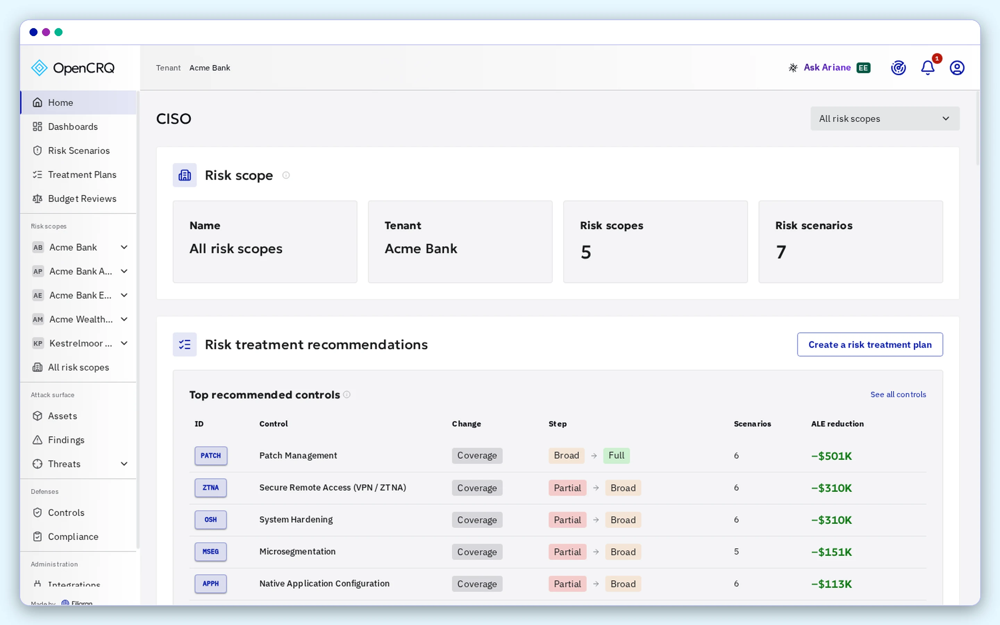
</picture>

## Table of contents

- [Why OpenCRQ](#why-opencrq)
- [Capabilities](#capabilities)
- [Gallery](#gallery)
- [How it works](#how-it-works)
- [Part of the XTM Platform](#part-of-the-xtm-platform)
- [Use cases by security role](#use-cases-by-security-role)
- [Quick start](#quick-start)
- [Editions](#editions)
- [Integrations and ecosystem](#integrations-and-ecosystem)
- [Community](#community)
- [Contributing](#contributing)
- [Security](#security)
- [License](#license)
- [About Filigran](#about-filigran)

## Why OpenCRQ

A CTEM program finds more exposures than any team can fix. Severity scores rank them by how bad a flaw is in general, not by what it would cost your organization.

- **Threat-informed and evidence-based.** Each risk scenario starts from the actors that target your sector and geography, and control effectiveness comes from what your attack simulations blocked or detected.
- **Financial.** Results are an annualized loss exposure with its range, split by loss driver, so they read in the language of a board and a budget.
- **Actionable.** Every result names the control, the finding or the technique that would reduce it most, priced in the same currency.

## Capabilities

| CTEM stage | What OpenCRQ gives your team |
|---|---|
| **Scoping** | Risk scopes per legal entity or business line, primary assets that carry the loss and the organization's financial profile, sector and countries. |
| **Discovery** | Supporting assets with their dependencies, consolidated across sources, CVE and technique findings, and the threats relevant to each tenant. |
| **Prioritization** | A risk scenario per attack outcome quantified by Monte Carlo: annualized loss exposure with p10, mean and p90 and a loss exceedance curve against your tolerance. |
| **Validation** | Controls mapped to MITRE ATT&CK techniques with their prevention and detection coverage, their effectiveness taken from OpenAEV simulation results. |
| **Mobilization** | Risk treatment recommendations, treatment plans, budget reviews and a remediation pace dashboard of new findings against closing capacity. |

## Gallery

<table>
  <tr>
    <td width="50%" valign="top">
      <picture>
        <source media="(prefers-color-scheme: dark)" srcset="./.github/img/readme/g1-dark.webp">
        <source media="(prefers-color-scheme: light)" srcset="./.github/img/readme/g1-light.webp">
        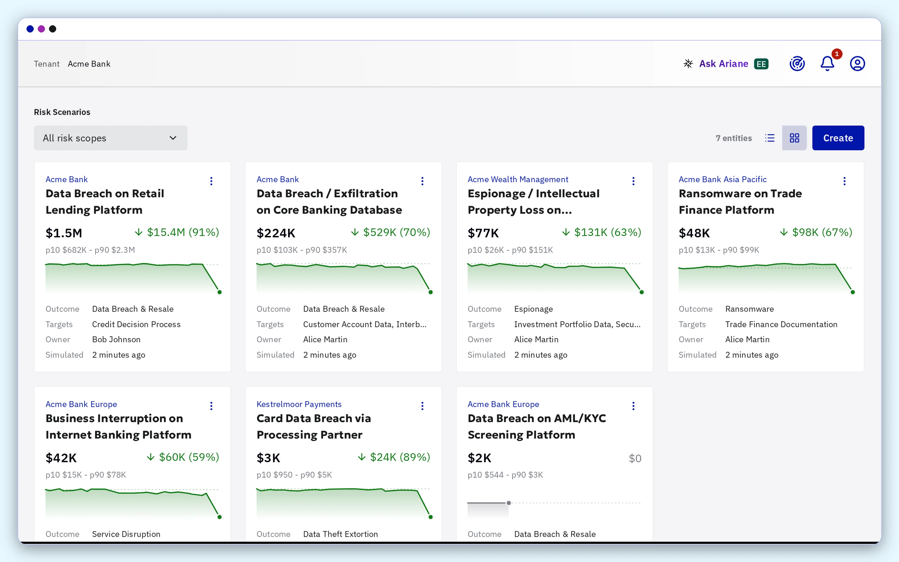
      </picture>
      <p><b>Risk scenarios.</b> Every risk you carry, priced and ranked, with its range, outcome and owner.</p>
    </td>
    <td width="50%" valign="top">
      <picture>
        <source media="(prefers-color-scheme: dark)" srcset="./.github/img/readme/g2-dark.webp">
        <source media="(prefers-color-scheme: light)" srcset="./.github/img/readme/g2-light.webp">
        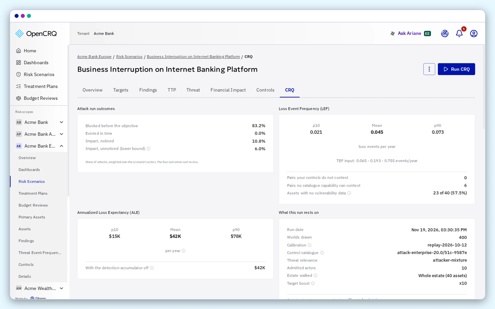
      </picture>
      <p><b>Quantification.</b> How attacks end against your defenses and what a loss event costs.</p>
    </td>
  </tr>
  <tr>
    <td width="50%" valign="top">
      <picture>
        <source media="(prefers-color-scheme: dark)" srcset="./.github/img/readme/g3-dark.webp">
        <source media="(prefers-color-scheme: light)" srcset="./.github/img/readme/g3-light.webp">
        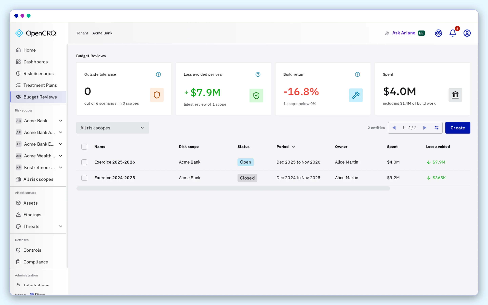
      </picture>
      <p><b>Budget reviews.</b> What the security budget spent and the loss it avoided, scope by scope.</p>
    </td>
    <td width="50%" valign="top">
      <picture>
        <source media="(prefers-color-scheme: dark)" srcset="./.github/img/readme/g4-dark.webp">
        <source media="(prefers-color-scheme: light)" srcset="./.github/img/readme/g4-light.webp">
        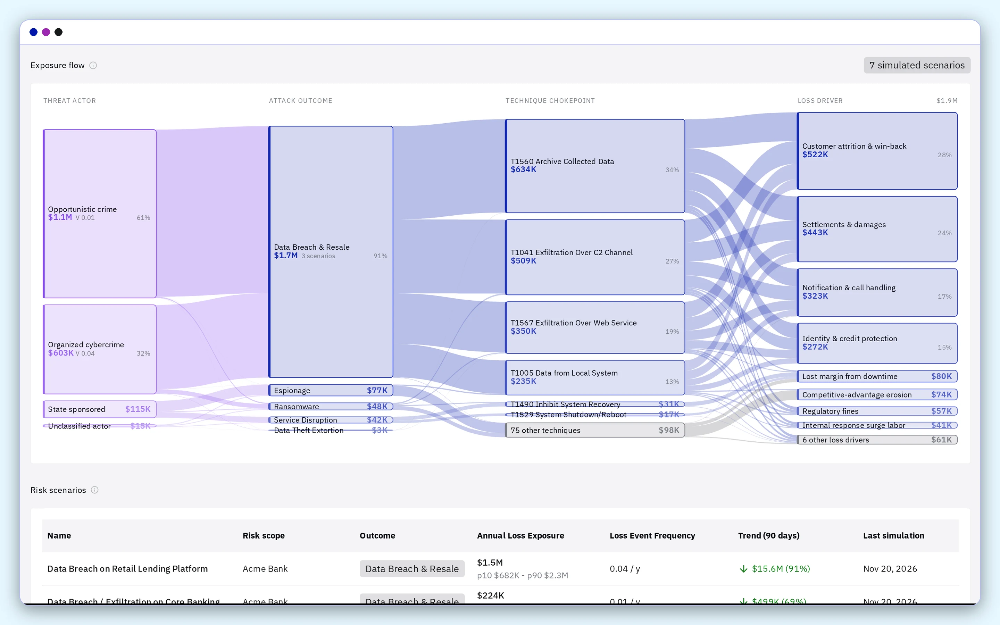
      </picture>
      <p><b>Exposure flow.</b> Where the annual loss comes from, down to the technique that would stop it.</p>
    </td>
  </tr>
  <tr>
    <td width="50%" valign="top">
      <picture>
        <source media="(prefers-color-scheme: dark)" srcset="./.github/img/readme/g5-dark.webp">
        <source media="(prefers-color-scheme: light)" srcset="./.github/img/readme/g5-light.webp">
        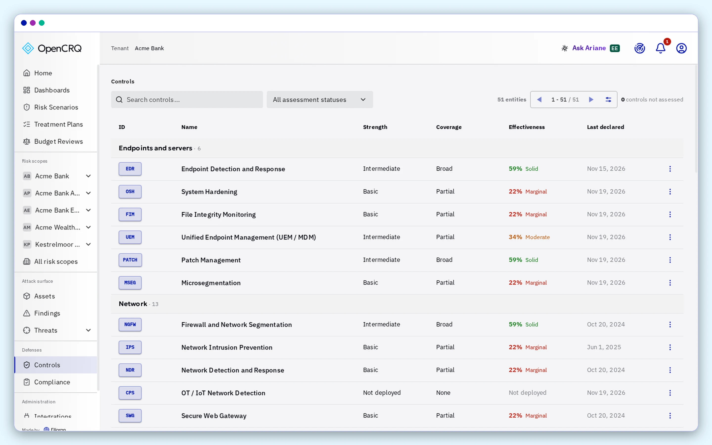
      </picture>
      <p><b>Controls.</b> Each control's strength, coverage and measured effectiveness, and what it protects.</p>
    </td>
    <td width="50%" valign="top">
      <picture>
        <source media="(prefers-color-scheme: dark)" srcset="./.github/img/readme/g6-dark.webp">
        <source media="(prefers-color-scheme: light)" srcset="./.github/img/readme/g6-light.webp">
        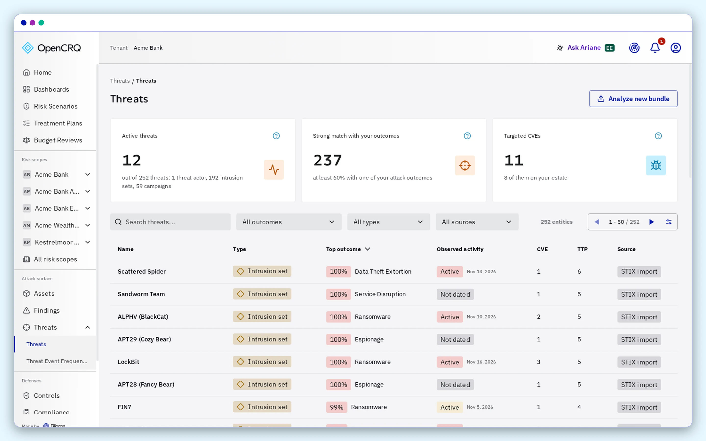
      </picture>
      <p><b>Threats.</b> The actors and campaigns that match your attack outcomes, with their CVEs and techniques.</p>
    </td>
  </tr>
</table>

**Walkthrough.** From the home dashboard to a risk scenario, its quantification and the control that cuts it, in 15 seconds.

<picture>
  <source media="(prefers-color-scheme: dark)" srcset="./.github/img/readme/walkthrough-dark.webp">
  <source media="(prefers-color-scheme: light)" srcset="./.github/img/readme/walkthrough-light.webp">
  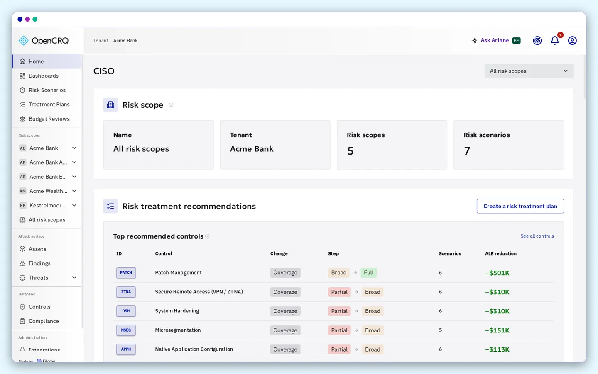
</picture>

## How it works

OpenCRQ reads threats from an OpenCTI live stream and assets, verdicts and CVEs from OpenAEV, builds one risk scenario per attack outcome on a primary asset and runs a Monte Carlo simulation in the FAIR vocabulary: threat event frequency, attack runs across the supporting assets, loss priced through the loss drivers, and what-ifs on the same simulated worlds so the value of each lever carries no sampling noise.

<picture>
  <source media="(prefers-color-scheme: dark)" srcset="./.github/img/readme/flow-dark.svg">
  <source media="(prefers-color-scheme: light)" srcset="./.github/img/readme/flow-light.svg">
  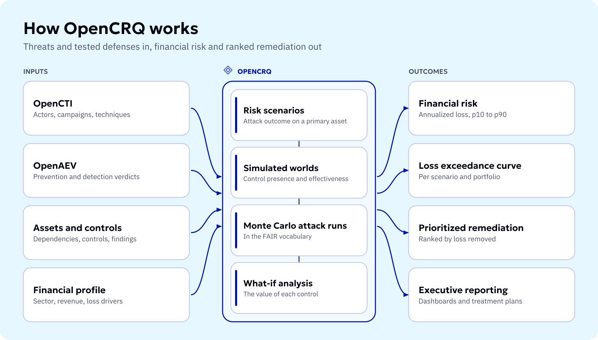
</picture>

## Part of the XTM Platform

OpenCRQ is one of the five products of the [XTM Platform](https://filigran.io), the open platform for Agentic CTEM. Each product owns stages of the CTEM loop; XTM One runs the loop across them.

<picture>
  <source media="(prefers-color-scheme: dark)" srcset="./.github/img/readme/xtm-platform-ctem-dark.svg">
  <source media="(prefers-color-scheme: light)" srcset="./.github/img/readme/xtm-platform-ctem-light.svg">
  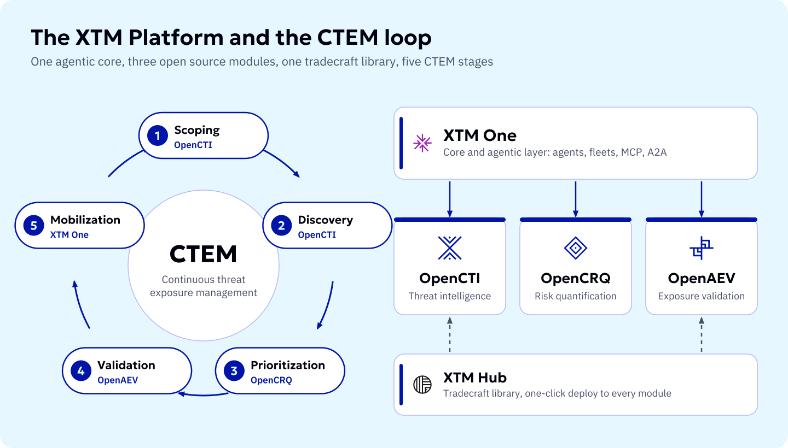
</picture>

| | Product | Role in CTEM | Repository | Product page |
|---|---|---|---|---|
| <picture><source media="(prefers-color-scheme: dark)" srcset="./.github/img/readme/mark-xtm-one-dark.svg"></picture> | **XTM One** | Core and agentic layer: runs CTEM across the modules and gets the fix done | [XTM-One-Platform/xtm-one](https://github.com/XTM-One-Platform/xtm-one) | [filigran.io/products/xtm-one](https://filigran.io/products/xtm-one) |
| <picture><source media="(prefers-color-scheme: dark)" srcset="./.github/img/readme/mark-opencti-dark.svg"></picture> | **OpenCTI** | Scoping and Discovery: know the adversary and the threats that target you | [OpenCTI-Platform/opencti](https://github.com/OpenCTI-Platform/opencti) | [filigran.io/products/opencti](https://filigran.io/products/opencti) |
| <picture><source media="(prefers-color-scheme: dark)" srcset="./.github/img/readme/mark-opencrq-dark.svg"></picture> | **OpenCRQ** | Prioritization: turn exposure into financial risk | [OpenCRQ-Platform/opencrq](https://github.com/OpenCRQ-Platform/opencrq) | [filigran.io/products/opencrq](https://filigran.io/products/opencrq) |
| <picture><source media="(prefers-color-scheme: dark)" srcset="./.github/img/readme/mark-openaev-dark.svg"></picture> | **OpenAEV** | Validation: prove your defenses against real attacker techniques | [OpenAEV-Platform/openaev](https://github.com/OpenAEV-Platform/openaev) | [filigran.io/products/openaev](https://filigran.io/products/openaev) |
| <picture><source media="(prefers-color-scheme: dark)" srcset="./.github/img/readme/mark-xtm-hub-dark.svg"></picture> | **XTM Hub** | Tradecraft library and gateway: integrations, dashboards and scenarios for every product | [XTM-Hub/xtm-hub](https://github.com/XTM-Hub/xtm-hub) | [filigran.io/platforms/xtm-hub](https://filigran.io/platforms/xtm-hub/) |

## Use cases by security role

| Role | What OpenCRQ does for it |
|---|---|
| **CTI** | The actors and campaigns that drive the loss, and the techniques that are the chokepoints. |
| **SOC** | The techniques where a detection removes the most loss, from OpenAEV verdicts priced in the same currency. |
| **Detection engineering** | A ranking of undetected techniques by the loss a detection would remove. |
| **Red and purple team** | Attack simulation results turned into control effectiveness and a priced risk reduction. |
| **Vulnerability and exposure management** | Findings ranked by the loss they carry on your estate, not by a generic severity score. |
| **Risk and CISO** | The annual loss exposure for the board, a tolerance and its trend, treatment plans and the spend justified by the loss it avoids. |

## Quick start

Requirements: Docker with Docker Compose.

```bash
git clone https://github.com/OpenCRQ-Platform/opencrq.git && cd opencrq/docker
cp .env.sample .env      # set XTM_ONE__URL, XTM_ONE__TOKEN and XTM_ONE__PLATFORM_URL
docker compose up --build --pull always -d
```

Open http://localhost:3020, then connect OpenCTI and OpenAEV from the connectors guides.

- **Guides**: [quick start](docs/quick-start.md) and [Docker deployment](docs/deployment/docker.md).
- **Docker**: [`filigran/opencrq`](https://hub.docker.com/r/filigran/opencrq).
- **Helm**: not available as a public chart; run the Docker image on Kubernetes with your own manifests and the [configuration](docs/deployment/configuration.md) reference.
- **Configuration**: [configuration](docs/deployment/configuration.md) and [architecture](docs/deployment/architecture.md).
- **Releases**: the [GitHub releases page](https://github.com/OpenCRQ-Platform/opencrq/releases).

## Editions

| | Community Edition | Enterprise Edition |
|---|---|---|
| License | [Apache 2.0](LICENSE) | [OpenCRQ Enterprise Edition License](LICENSE) |
| Risk scenarios, quantification, controls, dashboards | Yes | Yes |
| Multi-tenancy and the Filigran license | | Yes |
| The XTM One assistant | | Yes |

A source file without a license header belongs to the Community Edition; see [LICENSE](LICENSE).

## Integrations and ecosystem

- **XTM Platform:** OpenCTI threats through its [connector](docs/deployment/opencti-connector.md), OpenAEV assets and verdicts through its [connector](docs/deployment/openaev-connector.md), XTM One for Ariane and sign-in.
- **[XTM Hub](https://hub.filigran.io):** integrations, dashboards and scenarios for the XTM Platform.
- **Vulnerability data:** NIST NVD, CISA known exploited vulnerabilities and FIRST EPSS.
- **Estate and compliance:** Microsoft Defender for Endpoint, Entra ID and Intune through Microsoft Graph, and Drata for NIST CSF 2.0 evidence.

## Community

Star OpenCRQ to follow it and to help other security teams find it.

<picture>
  <source media="(prefers-color-scheme: dark)" srcset="./.github/img/readme/stars-dark.svg">
  <source media="(prefers-color-scheme: light)" srcset="./.github/img/readme/stars-light.svg">
  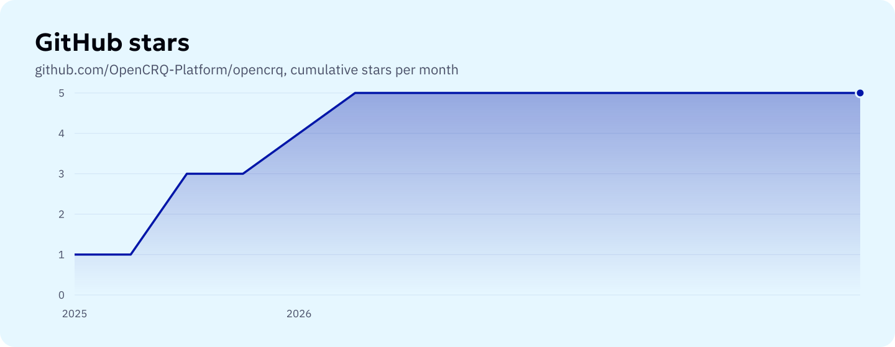
</picture>

- **Questions and discussion**: the Filigran [community Slack](https://community.filigran.io).
- **Bugs and feature requests**: [GitHub issues](https://github.com/OpenCRQ-Platform/opencrq/issues).
- **Learn**: free courses on [Filigran Academy](https://academy.filigran.io).

## Contributing

Read the [contributing guide](CONTRIBUTING.md) to set up a development environment and propose a change. OpenCRQ has adopted a [Code of Conduct](CODE_OF_CONDUCT.md). First contribution: the [good first issues](https://github.com/OpenCRQ-Platform/opencrq/labels/good%20first%20issue).

## Security

Report vulnerabilities privately as described in [SECURITY.md](SECURITY.md), never in a public issue.

## License

OpenCRQ is open source under the [Apache 2.0 license](LICENSE); the Enterprise Edition features are under the OpenCRQ Enterprise Edition License, as stated in [LICENSE](LICENSE) and in each source file header.

## About Filigran

OpenCRQ is designed and developed by [Filigran](https://filigran.io), the company behind the [XTM Platform](https://filigran.io) for Agentic CTEM.

<picture>
  <source media="(prefers-color-scheme: dark)" srcset="./.github/img/readme/filigran-dark.svg">
  <source media="(prefers-color-scheme: light)" srcset="./.github/img/readme/filigran-light.svg">
  
</picture>
